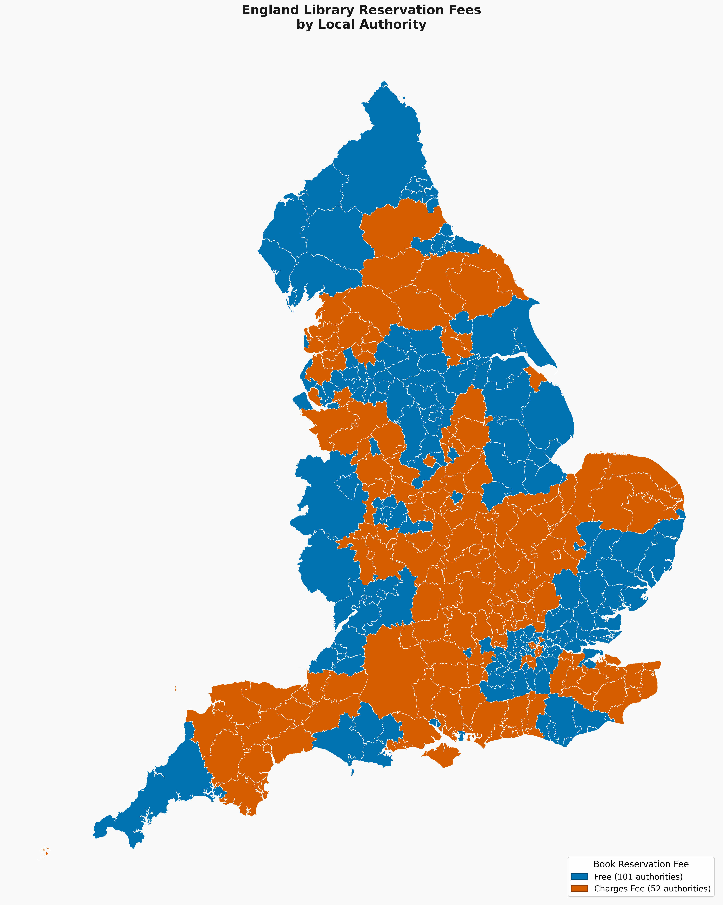

# England Library Reservation Fees Map

A project to visualise which library authorities across England charge fees for reserving library books online.



## Files

- `library_reservation_fees.csv` - Data on library reservation fees across all 153 English library authorities
- `generate_map.py` - Python script to generate geographic static and interactive maps
- `requirements.txt` - Python packages for geographic map
- `output/england_library_fees_map.png` - Generated static map
- `output/england_library_fees_map.html` - Generated interactive HTML map
- `output/england_library_fees_map.svg` - Generated static map (SVG format)
- `england_lad.geojson` - Cached England local authority district boundaries GeoJSON

## Quick Start

### Geographic Map (Full Features)

Generate static and interactive maps using actual authority boundaries:

```bash
# Install dependencies
pip install -r requirements.txt

# Generate static PNG map
python generate_map.py

# Generate interactive HTML map
python generate_map.py --interactive

# View data summary only
python generate_map.py --summary
```

## Data

The `library_reservation_fees.csv` file contains verified records for all 153 English library authorities:
- Authority name (`county`)
- Region (`region`: South West, South East, East of England, East Midlands, West Midlands, Yorkshire and the Humber, North West, North East, London)
- Country (`England`)
- Whether fees are charged (`charge_fee`: Yes/No)
- Amount (`amount`: e.g. £0.00, £0.50, £1.30)
- Fee description (`amount_notes`)
- Official source name (`source`)
- Official source URL (`source_url`)
- Verification date (`verification_date`)
- Notes on concessions and exemptions (`notes`)

### Summary (All 153 Authorities in England)

- **Free**: 101 authorities (66.0%)
- **Charges fee**: 52 authorities (34.0%)

### Regional Breakdown

| Region | Total Authorities | Free | Charges Fee |
| :--- | :---: | :---: | :---: |
| **East Midlands** | 10 | 5 | 5 |
| **East of England** | 11 | 4 | 7 |
| **London** | 33 | 23 | 10 |
| **North East** | 12 | 11 | 1 |
| **North West** | 24 | 19 | 5 |
| **South East** | 19 | 7 | 12 |
| **South West** | 15 | 8 | 7 |
| **West Midlands** | 14 | 11 | 3 |
| **Yorkshire and the Humber** | 15 | 13 | 2 |

## Usage Examples

### Basic usage
```bash
python3 generate_map.py
```

### Custom output file
```bash
python3 generate_map.py --output my_chart.png
```

### View data summary only
```bash
python3 generate_map.py --summary
```

### Geographic map
```bash
python generate_map.py --output uk_map.png
```

### Interactive map
```bash
python generate_map.py --interactive --output uk_map.html
```

## Contributing

Please help improve this dataset by:

1. Checking your local library's reservation policy
2. Submitting verified information via pull request
3. Updating the CSV with official sources 

## Technical Requirements

For geographic map (`generate_map.py`):
- Python 3.x
- pandas
- geopandas
- matplotlib
- folium
- shapely

## UK Counties GeoJSON

The geographic map script attempts to download UK county boundaries from:
- Primary: [ArcGIS Open Data](https://geoportal.statistics.gov.uk/)
- Fallback: [GitHub UK-GeoJSON repository](https://github.com/martinjc/UK-GeoJSON)

If both fail, manually download a GeoJSON file and save as `uk_counties.geojson`.

## Disclaimer

This data is compiled from various sources and may contain inaccuracies. 
Please verify with your local library service before relying on this information.

## Copyright

CSV and code written by Google Gemini 3.8 Flash. CC0 1.0 has been applied to all AI-generated code to cover jurisdictions where copyright status belongs to the prompter. 
